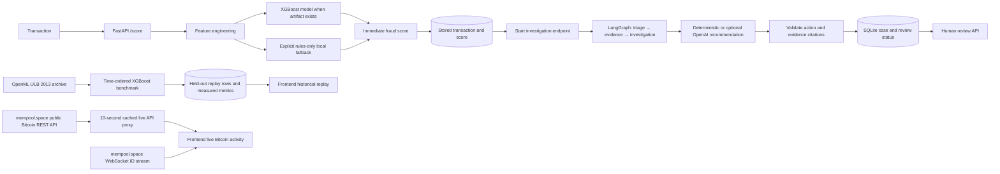

# Agentic Fraud Intelligence Platform MVP

A FastAPI fraud-scoring API with a separate LangGraph investigation workflow and human-review case endpoints. The immediate score and the investigation recommendation are separate decisions.



## What works

- `POST /api/v1/score` immediately returns a score and stores the transaction in the repository's existing data adapter. XGBoost scoring remains separate from asynchronous agentic investigation; **no LLM/provider call runs in the scoring request path**.
- `POST /api/v1/investigations/{transaction_id}` schedules a background LangGraph workflow for an already scored transaction. Triage uses a configurable score threshold (`INVESTIGATION_SCORE_THRESHOLD`, default `0.6`), risk level, and risk factors. Low-risk cases skip the provider.
- Evidence tools read a stored profile and earlier transactions through the existing `Database` and `RedisCache` interfaces. Missing data is marked `insufficient_evidence`; the workflow never creates historical transactions. Recommendations cite IDs of retrieved evidence.
- Each investigation returns a deterministic `evidence.gaps` brief: missing recent history, amount baseline, device baseline, or country baseline, with a specific analyst check for each. It lists only signals the repository could not retrieve; it does not claim the suggested check was performed. This helps reviewers see what would make the case more reliable instead of relying on a score alone.
- The investigation node can call OpenAI's Responses API with strict structured JSON output when `INVESTIGATION_PROVIDER=openai` and `OPENAI_API_KEY` are set. It receives the score, deterministic rule, transaction amount/country/category, and retrieved evidence with temporary aliases instead of raw account IDs. Its recommendation is checked against the evidence IDs actually retrieved. Default mode is deterministic and needs no key. If the model is unavailable, deterministic fallback is recorded and requires human review; invalid output fails validation and marks the case `FAILED`.
- Local recommendation confidence values are rule-assigned and uncalibrated; they are not measured model accuracy.
- Cases require human review for low confidence (`HUMAN_REVIEW_CONFIDENCE_THRESHOLD`, default `0.7`), insufficient evidence, rules/recommendation disagreement, `BLOCK`, or model fallback. Saved `review_reasons` names each trigger. A case also reports `investigation_mode` (`openai` or `deterministic`) and `provider_fallback`; model confidence is self-reported, not calibrated.
- Case and reviewer decisions are saved in a local SQLite file (`CASE_DB_PATH`, default `cases.sqlite3` relative to the backend working directory). They remain available after an API restart.
- A separate real-world benchmark uses anonymized ULB/Worldline card transactions from September 2013, downloaded from [OpenML dataset 1597](https://www.openml.org/data/v1/download/1673544/creditcard.arff). A time-ordered XGBoost train/validation/test split creates a held-out replay and measured metrics. The frontend now shows these recorded rows rather than random statistics. This is **historical data, not a live payment feed**.
- A separate live tab combines the latest **10** unconfirmed Bitcoin mainnet transactions with fee/size/value from the [mempool.space REST API](https://mempool.space/docs/api/rest) and a [low-bandwidth WebSocket stream](https://mempool.space/docs/api/websocket) of newly added transaction IDs. While open, the browser displays up to **500** distinct IDs. Stream-only IDs have no fee/size/value until seen in a REST snapshot or fetched individually with **Load details** (`GET /api/v1/live/bitcoin/tx/{txid}`); details are never fetched automatically for hundreds of IDs. “First seen” is the browser’s observation time, and disconnects can miss events. These are **not card payments and carry no fraud labels**; the card-fraud scorer and investigator do not process them.
- The frontend's **Investigate a transaction** tab exposes the submitted-card API flow, provider configuration (`GET /api/v1/investigations/provider-status`), saved evidence and gaps, actual `openai`/`deterministic` case mode, review reasons, and a human review form. It does not fabricate a live card feed or expose the API key.

The local benchmark run used 199,364 training rows, 42,721 validation rows, and 42,722 test rows (52 labeled fraud). On that test portion it measured average precision `0.7626`, ROC-AUC `0.9827`, precision `0.8810`, and recall `0.7115` at a threshold chosen on validation. These are archive-specific results, not performance claims for the original `/score` API or future live payments.

## Run locally

Use Python 3.11 and Node 20. From the repository root:

```bash
python3.11 -m venv .venv
source .venv/bin/activate
pip install -r backend/requirements.txt
cd backend
DEBUG=false uvicorn app.main:app --reload --port 8000
```

To build the real-world archive without an account or API key, from the repository root:

```bash
mkdir -p ml/data
curl -L --fail https://www.openml.org/data/v1/download/1673544/creditcard.arff -o ml/data/creditcard.arff
cd ml && python train_real.py && cd ..
```

Then run `cd frontend && npm ci && npm run dev` in a second terminal. API docs are at `http://localhost:8000/docs`; the three tabs are at `http://localhost:3000`. The live REST endpoint is `GET /api/v1/live/bitcoin/recent`; archive endpoints are `GET /api/v1/archive/metadata` and `GET /api/v1/archive/rows?after=-1&limit=20`. For the original transaction-scoring API, an optional synthetic sample artifact can be produced with `cd ml && python train.py --sample`; set `MODEL_PATH` to that output. Without an artifact, `/score` reports `rules-only` and uses deterministic rules. The archive's XGBoost model is separate because its anonymized columns do not match the `/score` transaction schema.

To use a real model for flagged investigations, set `INVESTIGATION_PROVIDER=openai`, `OPENAI_API_KEY` to your own API key, and optionally `OPENAI_MODEL` (default `gpt-4.1-mini`) before starting the API. For Docker, put these in an ignored root `.env` or export them before `docker compose up`. [Responses API structured-output documentation](https://platform.openai.com/docs/api-reference/responses/create). Without a key the workflow still runs locally in deterministic mode; an explicit `openai` mode with an unavailable key records fallback. Do not send real cardholder data until the integration has privacy and access controls.

The archive table fetches 20 rows per page from 42,722 held-out rows. Use **Load next 20**, **Play replay**, or **Show known fraud only**; the table keeps the latest 100 displayed to stay responsive.

Docker Compose defines API, PostgreSQL, Redis, frontend, Prometheus, and Grafana services: after `train_real.py`, run `docker compose up --build -d`. Compose mounts the archive artifact read-only and a named volume for the SQLite case file. The current `Database` and `RedisCache` Python adapters still use in-memory dictionaries for transactions, profiles, and cache entries.

## Example

```bash
curl -s -X POST http://localhost:8000/api/v1/score \
  -H 'Content-Type: application/json' \
  -d '{"transaction_id":"TXN-1","user_id":"U000001","amount":5000,"merchant_category":"crypto_exchange","country":"NG","device_id":"new-device"}'
curl -s -X POST http://localhost:8000/api/v1/investigations/TXN-1
curl -s http://localhost:8000/api/v1/investigations/<case_id>
curl -s http://localhost:8000/api/v1/review/cases
curl -s -X POST http://localhost:8000/api/v1/review/cases/<case_id> \
  -H 'Content-Type: application/json' \
  -d '{"reviewer":"analyst-1","final_action":"REQUEST_VERIFICATION","note":"Verify customer identity"}'
```

The start endpoint returns `PENDING`; retrieve the case by its returned `case_id`. A result has this shape (values depend on the stored transaction and evidence):

```json
{
  "recommended_action": "BLOCK",
  "confidence": 0.88,
  "risk_summary": "Critical score with at least two corroborating account, device, location, or velocity anomalies.",
  "evidence_ids": ["score:TXN-1", "profile:U000001:amount", "profile:U000001:country"],
  "requires_human_review": true
}
```

For a new account with no stored profile or history, `evidence.gaps` includes records such as `{"signal":"RECENT_HISTORY","reason":"No earlier transactions are stored for this account.","next_check":"Check permitted payment history before deciding whether this is a new pattern."}`. The case requires review because evidence is insufficient.

`GET /api/v1/review/cases` lists review-required cases. `POST /api/v1/review/cases/{case_id}` stores a reviewer's final action and note, including an override. `GET /api/v1/investigations/{case_id}` returns the saved final status.

## Tests

```bash
cd backend
DEBUG=false pytest tests -q
```

The suite covers scorer/API behavior, graph triage, evidence gaps and missing timestamps, insufficient evidence, low confidence, mocked OpenAI structured responses and fabricated-citation rejection, provider fallback, saved human override, archive cursor/API behavior, and live upstream validation/failure. Frontend WebSocket ID parsing and accumulation: `cd frontend && npm test`; build: `npm run build`.

## Current limits

This is a local MVP, not a deployed decisioning system. The live Bitcoin feed can fail or be rate-limited by its public upstream and has no confirmed fraud outcomes. The ULB archive has real labels but only `Time`, `Amount`, and anonymized `V1–V28`; it provides no stable customer, device, merchant, or country evidence. Neither source can serve as a live pre-payment **card** fraud feed or run the existing evidence investigation for its missing fields. Transactions and user profiles in the original API remain process-local; only case/review records are saved to SQLite. There is no authenticated reviewer role, payment-company integration, email alert, or live OpenAI call verified without a credential. PostgreSQL and Redis containers exist in the Docker stack but the Python adapters do not yet connect to them. Benchmark model scores are not calibrated probabilities; use a real payment source and domain-specific validation before making real decisions.
